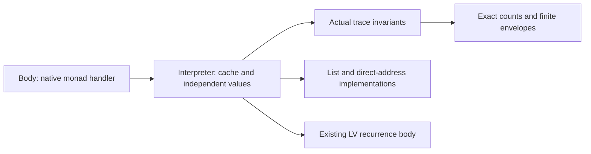

# Checked native memo core, 2026-11-16

**Follow-up:** [exact LV correspondence](memo-lv-correspondence.md) now closes
the existing-evaluator value/table/counter bridge and instantiates D-product
warm/multi-root bounds. The initial-core evidence below records its original
scope; the unrelated client and complete representation envelopes remain open.

This is a **C1 interpreter theorem** following the native backend decision.
It proves actual sequential evaluation and counting, rather than assuming a
global memo runtime bound. It does not establish correspondence with the old
LV evaluator, generated Rust or the reified source interpreter. Those bridges,
the unrelated full client and representation-specific work envelopes remain
open. W04 and W05 are partial; W06-C3 remains open.

The [statement/reuse audit](memo-statement-audit.md) records inspected upstream
declarations, exact revisions, selected compatibility checks and limitations.

## Implementation and dependency boundary

All paths below are under `proofs/SubtreeProofs/Complexity/`.

| Module | Checked content |
| --- | --- |
| `Memo/Body.lean` | Finite `done`/`pay`/`ask` bodies, value-dependent continuations, actual direct-request lists, local currency, effect-preserving monadic erasure, handler-based body correctness and request balance. |
| `Memo/Interpreter.lean` | Actual native `EStateM` evaluator, immutable counted reads, counted insertion, independent value specification, cache validity/soundness/preservation, rank frame, native Std.WP, sequential multiple roots. Any well-founded dependency relation yields a mathematical natural-height certificate. |
| `Memo/Trace.lean` | Actual emitted lookup/completion events; exact request balance for every successful run; distinct, initially absent and still-live completion keys; exact final cache domain; canonical body metadata for sound runs; exact priced-event partition. |
| `Memo/Bounds.lean` | Root-plus-body identity, execution-derived finite closure, initially-absent expansion bound, nonuniform request-envelope sum, uniform branching corollary and local priced-event composition. |
| `Memo/Representations.lean` | First-hit association-list scan and dense bounded-key array, each with proved `CacheOps` laws. Explicit initialization counters and actual representation operation counters. |
| `Paper2004/MemoBody.lean` | Existing independent `paperLcs` recurrence, its four-request body in the maintained evaluator's order, local correctness and descent. No replacement optimum definition. |

Generic `Memo/` modules import only Std/Mathlib and each other. The tree/Rust
dependency boundary is one-way: only the local `Paper2004/` adapter imports
the existing paper development. No new resource monad, predicate-transformer
engine, upstream dependency or generated-source edit was introduced.



## Exact semantic contract

`Problem.value` is an independent function. `Problem.body_correct` proves the
cache-free body computes it when requests receive independent correct answers.
`requests_decrease` concerns that valid-response path; `Body.run_spec` proves
sound caches force the actual path to coincide, including value-dependent
branches. Bodies cannot directly inspect or modify the cache.

The executable `eval` receives **only cache operations, body, fuel and key**,
not the independent answer or a termination proof. A hit works at any fuel.
A miss at zero fuel returns an error and its partial state. Success/totality
is proved under valid/sound initial storage and `rank key < fuel`. Each root
receives the cache left by its predecessor. The well-founded height conversion
is mathematical; it is not an executed prepass or a claimed free computation.

`eval_spec`, `eval_correct`, `eval_wp` and `evalRoots_spec` prove correctness
and preservation. `evalRoots_trace_spec` additionally proves `TraceInvariant`
for any trace origin; `TraceInvariant.initial` starts with empty metadata and
arbitrary sound warm storage. The invariant proves distinct completed keys,
their initial absence and current presence, preservation of original entries,
no unlogged cache entries, and exact canonical body request/local-work metadata.
`TraceInvariant.domain_eq` gives initial-domain union completed keys exactly.
The trace is reverse chronological proof metadata, not asserted physical
memory residency or free instrumented Rust execution.

With `X` the actual completed-key list, `roots_request_identity` proves

```
calls(final) = roots.length + sum (k in X.toFinset) canonicalRequests(k).length.
```

Canonical requests here equal the actual completed body's request list by the
trace invariant. Repeated root and body-request occurrences remain counted.
`evalRoots_balance` proves its underlying balance even without soundness for
every successful run. It does not infer correctness from the balance alone.

For a finite envelope `S` containing roots and closed under canonical requests,
`eval_scope`/`evalRoots_scope` prove completed keys actually stay in `S`.
`roots_envelope` then proves termination/correct values and

```
X.length <= (S.filter (initial contents is none)).card
calls(final) <= roots.length + sum (k in S with initial contents none) arity(k).
```

Only local request arities are premises. Arbitrary sound warm entries outside
`S` are allowed. `roots_call_bound` retains the existing shape
`calls <= roots.length + branching * X.length`. Recovering the old evaluator's
single-root `4 * misses + 1` theorem still requires actual correspondence.

## Cost and representation boundary

`Event.totalWork_eq` partitions declared event work exactly into request
overhead times calls, expansion overhead times completions, lookup work,
insertion work and body-local work. `Event.totalWork_le` composes local emitted
read/write/body budgets. It does **not** prove that these budgets hold for a
particular full representation run; that remains a named MEM-03 obligation.

List reads count whole-key equality tests performed by their actual scan and
are proved at most the current list length; insertion costs one declared cons.
The direct-address implementation uses `Fin capacity` keys, valid array length,
one declared cell read/write, and explicitly initializes each cell. The setup
count is `capacity + 1`, versus one empty-list construction. A key-to-dense-index
map, structural-key comparison/copy, persistent-array copying, allocation,
overflow and source realization need separate contracts. No claim identifies
these narrow primitive currencies with total Lean or Rust runtime.

The LV body's local `pay 4` counts two score additions and two maxima only.
Tests, body/key construction and dictionary/source work are separate. The
adapter proves a local recurrence fits, not an end-to-end LV cost theorem.

## Discriminators and verification

`Tests/Memo.lean` checks empty roots, duplicate children and roots, warm hits
with zero fuel, cold zero-fuel failure, value-dependent early exit, an unsound
cache and initialization costs. The same body has six calls/three expansions
under both representations but lookup counters four versus six on its cold
two-root case; a fully warm two-root case costs six versus two. These are exact
small-input examples, not asymptotic or benchmark claims.

A deliberately reset sibling-cache handler returns the same correct parent
value while logging `[parent, base, base]`. This fails distinct expansion and
exhibits the missing sharing guarantee. It is a C1 adversary, not a new Rust
source mutation. The toy test is not counted as the unrelated W05 client.

From the repository root after configuring VM caches:

```bash
(cd proofs && lake build)
(cd proofs && lake env lean Tests/Memo.lean)
(cd proofs && lake env lean BaselineAudit.lean)
```

The example uses kernel-checked `decide +kernel`, not native decision axioms.
The suite is registered in the verification workflow. The baseline audit lists
sixteen new core/representation/LV endpoints; no new axiom is intended or
permitted beyond the existing `propext`, `Classical.choice`, `Quot.sound` set.
The final validation count and audit outcome are recorded in `RESUME.md` and
`proofs/PROOF_STATUS.md` after execution.

## Remaining work

1. **Completed in the [LV follow-up](memo-lv-correspondence.md):** exact
   value/cache/call/miss/comparison correspondence and warm D-product bounds.
2. Supply the unrelated independently specified edit-distance client and its
   correctness/closure/local-cost obligations.
3. Prove run-level primitive budgets and final priced envelopes for both
   representations, including initialization, key conversion and finalization.
4. Complete W04's other D1–D4 substitution/size/adequacy contracts and the
   campaign's independent review; this implementation addresses the D7 core
   and part of D8, not every interface in that assignment.
5. Continue the separately named W06-C3 source/reification/heap/memo bridge.
   Generic C1 proofs do not finish SRC-01, MEM-04 or APP-01.
